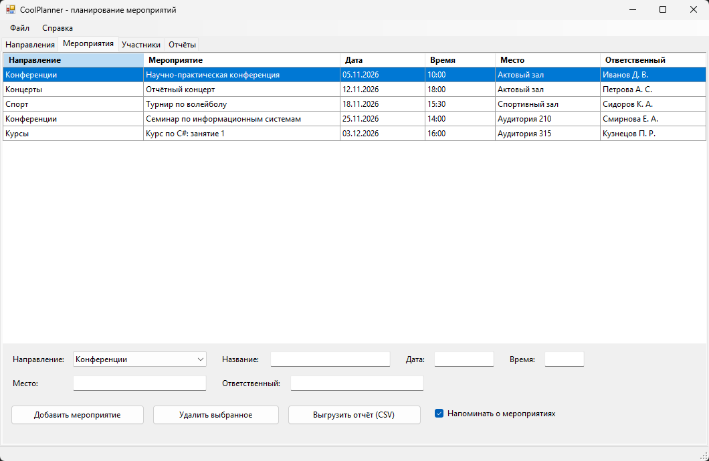
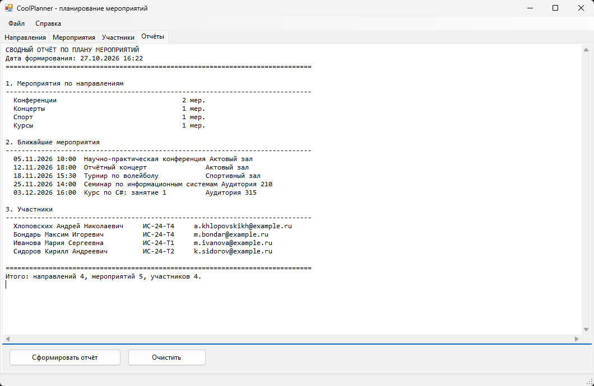

# CoolPlanner

Информационная система планирования и учёта мероприятий. Учебный проект на **Windows Forms** (.NET Framework 4.7.2, C#).

## Возможности

- справочник направлений (категории мероприятий);
- карточки мероприятий: направление, название, дата, время, место, ответственный;
- справочник участников: ФИО, группа, e-mail, телефон;
- модуль отчётов: сводка по направлениям, ближайшие мероприятия, список участников;
- выгрузка списка мероприятий в CSV (разделитель `;`, UTF-8 с BOM);
- фоновые напоминания о мероприятии за 30 минут (таймер, интервал 60 секунд).

## Скриншоты

### Список мероприятий



### Отчёты



## Как запустить

1. Открыть `CoolPlanner.sln` в Visual Studio 2019/2022.
2. Собрать и запустить (F5).

Либо собрать из консоли:

```powershell
msbuild CoolPlanner.sln /p:Configuration=Debug
```

Данные хранятся в файле `coolplanner.xml` рядом с исполняемым файлом и загружаются при запуске.

## Структура проекта

| Файл | Назначение |
|---|---|
| `Models.cs` | сущности (направление, мероприятие, участник) и работа с XML-хранилищем |
| `MainForm.cs` | интерфейс, обработчики событий, проверка вводимых данных, отчёты, CSV, таймер |
| `Program.cs` | точка входа |

## Технологии

C#, Windows Forms, .NET Framework 4.7.2, XML-сериализация, `System.Windows.Forms.Timer`.
